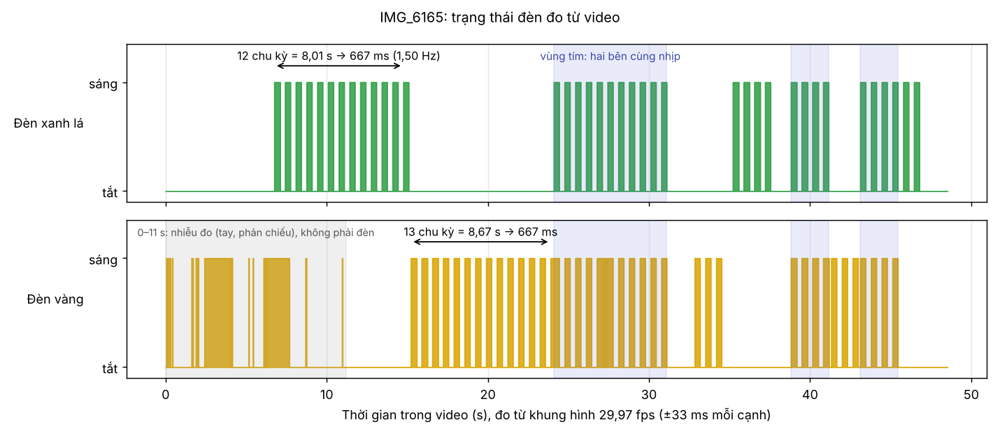
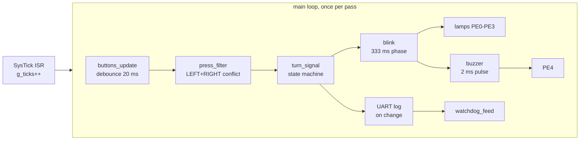
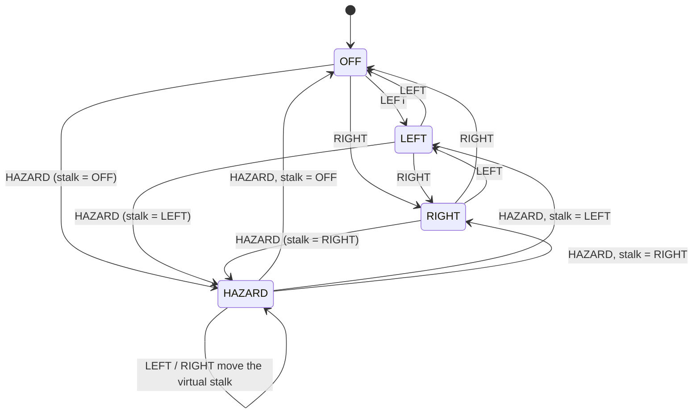

# Turn signal & hazard controller (TM4C123, bare-metal C)

Button-controlled turn signals and hazard lights for a car, written in register-level C on the
**EK-TM4C123GXL LaunchPad** (TM4C123GH6PM, Arm Cortex-M4F). No TivaWare, no HAL: every peripheral
(GPIO, SysTick, UART, watchdog) is configured from the datasheet.

The application logic is plain C with no hardware access, so it is unit-tested on a PC
(58 Unity tests). Every requirement is traced to a unit test and a board check with recorded evidence.



Demo video (board run, R1-R6 and R13): [`docs/evidence/evidence_R1-R6_R13.mp4`](docs/evidence/evidence_R1-R6_R13.mp4)

---

## What it does

| Button | Behaviour |
|---|---|
| LEFT / RIGHT | Front and rear lamps of that side flash at **1.5 Hz** (333 ms on, 333 ms off). The lamp lights **at once** on the press. Press the active side again to turn it off; press the other side to switch. |
| HAZARD | All four lamps flash in sync and **override** LEFT/RIGHT. |
| LEFT/RIGHT during hazard | Lamps stay on hazard, but a **virtual stalk** remembers the choice (same toggle rules). Pressing HAZARD again returns to it, like a real car whose stalk takes over when hazard goes off. |
| Hand across LEFT and RIGHT | The button touched first wins; the later one is ignored while the first is held. Both in the same loop pass: both ignored. HAZARD is never blocked. |
| Buzzer | A passive buzzer gives a relay-like "tick" on every lamp edge, silent in OFF. |
| Fault | A watchdog resets the chip if the main loop stops for 500 ms; it restarts in OFF and logs `reset: watchdog`. |

UART0 (115200 8N1, LaunchPad virtual COM port) logs one line per state change: `state=LEFT`.

---

## Hardware

| Signal | Pin | Notes |
|---|---|---|
| Front-left / rear-left lamp | PE0 / PE1 | LED + series resistor to GND, active-high |
| Front-right / rear-right lamp | PE2 / PE3 | |
| Buzzer | PE4 | passive buzzer, low-side 2N2222 with base resistor, 1N4148 across the buzzer (cathode to +3.3 V) |
| LEFT / RIGHT / HAZARD button | PB0 / PB1 / PB2 | to GND, internal pull-up, active-low |
| UART0 RX / TX | PA0 / PA1 | on-board debug chip, shows up as "Stellaris Virtual Serial Port" |

System clock: 50 MHz from the PLL (`SystemCoreClock`). Every divisor (SysTick, UART baud,
watchdog load) is computed from it at run time.

Why a transistor for the buzzer: the coil is about 16 ohm, so 3.3 V would draw about 200 mA;
a TM4C pin is rated for 8 mA at most. The buzzer gets a 2 ms pulse per edge instead of a level,
so the average coil current is about 1 mA.

---

## Software architecture



```
app/        pure C, no register access, unit-tested on the PC:
            turn_signal (state machine), blink (1.5 Hz phase), press_filter (button conflicts),
            buzzer (tick pulses)
firmware/   Keil uVision project: startup, drivers (gpio, lamps, systick, buttons, uart), main.c
            (watchdog.c/.h also sits in app/, the one hardware driver outside firmware/)
tests/      Unity tests run with GCC on the PC; tests/unity is a git submodule
docs/       design.md (decisions and why), devlog.md, test_plan.md, evidence/
```

Rules the code follows:

- **ISRs do one thing.** SysTick only increments `g_ticks`; all work happens in the main loop.
- **Time is passed in.** Logic takes `now_ms` as a parameter instead of reading `g_ticks`, so tests drive it
  with fake ticks (0, 333, 666 ...) and run in milliseconds without a board.
- **One time value per pass.** `main` reads `g_ticks` once, so every module sees the same instant.
- **Elapsed time as `(now - last) >= N`** with `uint32_t`, correct across the 32-bit wrap after ~49.7 days.
- **`main` only moves values.** Every decision (which lamp, when to tick, which press to drop) lives in
  tested code; `main` reads inputs and writes outputs.

### State machine



LEFT/RIGHT use a 3 x 2 lookup table; HAZARD is handled in code because it reads and writes the stalk.
Out-of-range events and corrupted states are rejected before any table access (C does not check bounds).

### Watchdog (WDT0)

- Fed on the **last line of the main loop**, never in an ISR: SysTick keeps running when `main` hangs,
  so feeding there would hide exactly the fault the watchdog exists for.
- Time-out 500 ms (the longest normal loop pass is about 1 ms). WDT0 resets on its second time-out,
  so the load value is half of that.
- `STALL` is set, so a debugger breakpoint does not reset the chip.
- The reset cause (`RESC`) is read first thing in `main`, printed, and cleared.

Design decisions with the alternatives that were rejected: [`docs/design.md`](docs/design.md).

---

## Verification

### Unit tests (PC, GCC + Unity)

| Suite | Tests | Covers |
|---|---|---|
| `test_turn_signal.c` | 17 | every cell of the stalk table, hazard priority, virtual stalk, input guards |
| `test_blink.c` | 13 | 333 ms phase, immediate light on change, catch-up after a stalled loop, 32-bit tick wrap |
| `test_press_filter.c` | 15 | LEFT+RIGHT conflict rules, HAZARD always passes, NULL guards |
| `test_buzzer.c` | 11 | pulse per lamp edge, silent in OFF, one click per hazard edge, runs with the real blink + turn_signal |
| `test_smoke.c` | 2 | framework check, tick wrap-around rule |
| **Total** | **58** | all pass, built with `-Wall -Wextra` and no warnings |

Tests were checked against deliberately broken code (for example `last = now` instead of `last += 333`)
to make sure they fail when they should.

### Requirements on the board

Full table with test names and evidence files: [`docs/test_plan.md`](docs/test_plan.md).

| Requirement | Result on the board | Evidence |
|---|---|---|
| R1 1.5 Hz ±10 %, 50 % duty | 12 cycles in 8.01 s: **667 ms (1.50 Hz)**, on 334 ms, measured frame by frame from video (29.97 fps) | timeline PNG, video |
| R5/R6 hazard in sync | both sides light in the same video frame (< 33 ms apart) | video |
| R7 one press = one event | 20 presses -> 20 events; 3 s hold -> 1 event | UART log |
| R8 lamp on within 100 ms | **20 ms** on 20/20 presses (temporary probe on PB0, 1 ms resolution) | UART log |
| R9 button held during reset | no event, lamps off | UART log |
| R12 / R13 conflicts, virtual stalk | all cases as specified | UART log, video |
| R11 buzzer | tick on every lamp edge, silent in OFF, by ear | - |
| Watchdog | forced hang (`WDT_SELFTEST`) resets the chip; log shows `reset: watchdog` | - |

Open items, stated plainly: "press shorter than 20 ms is ignored" (R7) cannot be produced reliably by hand
and needs a `test_buttons.c`; R12 "RIGHT touches first" has not been run on the board yet.

### Static analysis

Cppcheck 2.13 with all checks enabled on `app/` and `firmware/`: **0 findings**. The first run found 3
(a pointer that should be `const`, an unused function, and one false positive for `SysTick_Handler`,
which is called from the vector table and is suppressed with a comment). Report:
[`docs/evidence/cppcheck_report.txt`](docs/evidence/cppcheck_report.txt).

---

## Bugs found on the way

| Symptom | Cause | How it was found |
|---|---|---|
| LED glowed dimly instead of blinking | `last` never updated, so the LED toggled on every loop pass | reasoning about the loop; fix `last += period` (also prevents drift) |
| LED off although the data register was right | GND wire in the wrong breadboard hole | register was correct in the debugger, so the fault had to be outside the chip |
| Events while a button was held, flicker | loose resistor in the button path | bypassed the button: wire to GND directly was stable |
| One press sometimes gave two events | `last_edge_ms` retyped as `uint8_t`: time truncated, debounce disabled | measured the bounce first (max 4-5 ms, pin clean), so the window was not the problem |
| Terminal blank on COM3, lamps fine | debug chip's virtual COM port stuck | read the UART registers (all correct); the banner is longer than the 16-byte FIFO, so a stuck TX would have hung `main` and the lamps would not run. Replugging USB fixed it, no code change |
| Buzzer silent and LEFT gave no event | bad breadboard GND rail | common factor of both faults was GND; wiring both straight to a LaunchPad GND pin fixed them |
| Linker L6218E `undefined symbol buzzer_init` | `buzzer.c` not added to the Keil project | the header compiled, but no object defined the function |
| Linker L6200E `main multiply defined` | `main.c` content pasted into `buttons.c` | file names are in the error; restored `buttons.c` from git |

---

## Build and run

**Unit tests** (repo root, GCC, e.g. MSYS2 UCRT64 on Windows):

```
git submodule update --init
gcc -std=c99 -Wall -Wextra -I tests/unity/src -I app tests/test_turn_signal.c app/turn_signal.c tests/unity/src/unity.c -o build/test_turn_signal.exe
build\test_turn_signal.exe
```

Same pattern for the other suites (`test_blink` needs `app/blink.c app/turn_signal.c`, `test_buzzer` needs
`app/buzzer.c app/blink.c app/turn_signal.c`, `test_press_filter` needs `app/press_filter.c`).

**Firmware:** open `firmware/project.uvprojx` in Keil uVision 5 (ARM Compiler 6, C99), build, flash over
the debug USB port, then open a terminal on the "Stellaris Virtual Serial Port" at 115200 8N1.

**Static analysis:**

```
cppcheck --enable=all --inconclusive --std=c99 --platform=unix32 -I app -I firmware --suppress=missingIncludeSystem --inline-suppr app firmware
```

---

## What I learned

- Reading the datasheet for every register: clock gating and the peripheral-ready wait, masked GPIO data
  addresses, PCTL mux fields, UART baud divisors, the two-stage watchdog.
- Separating logic from hardware makes the logic testable in seconds and the drivers small.
- Measure before changing code: two of the hardest bugs were wiring, and one "debounce bug" was a type.
- Writing requirements that can be tested, and keeping them in step with design decisions made later.
- Deciding where a safety mechanism goes: a watchdog fed from an interrupt protects nothing.

## License

MIT, see [`LICENSE`](LICENSE).
